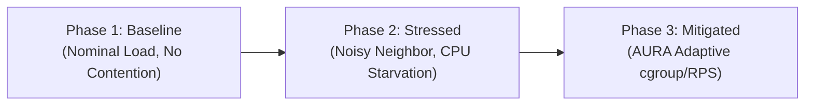

# AURA Research Experiment Methodology

**Project:** AURA — Adaptive Root-Cause-Aware Control for Tail-Latency Optimization in Linux Host Networking  
**Document Type:** Scientific & Empirical Evaluation Methodology  
**Target:** Academic Capstone Defense, Performance Systems Evaluation, and Peer Review  

---

## 1. Research Objectives & Hypothesis

AURA evaluates adaptive, host-level kernel resource tuning to alleviate tail-latency degradation in Linux network services.

### Core Research Hypothesis
> Under host-level resource contention (CPU starvation, softirq backlog, or packet drop cascades), dynamic root-cause-aware adaptation of cgroup v2 CPU shares (`cpu.weight`) and network steering (RPS) reduces P99 and P99.9 tail latencies by at least 25% compared to static unmitigated baselines, without sacrificing peak throughput or violating stability invariants.

---

## 2. Metric Definitions & Statistical Foundations

### 2.1 Benchmark Performance Metrics
- **Throughput ($RPS$):** Exact completed requests per unit time:
  $$\text{Throughput} = \frac{\text{Successes}}{\Delta t_{\text{actual}}}$$
  where $\Delta t_{\text{actual}} = \min(w_s, t_{\text{end}} - t_{\text{start}})$.
- **Tail Latency Percentiles:** Computed via the 1-indexed nearest rank method:
  $$r = \lceil p \times N \rceil, \quad \text{Latency}_p = \text{SortedSamples}[r - 1]$$
  Evaluated at $p \in \{0.50, 0.90, 0.99, 0.999\}$.

### 2.2 Host Telemetry Signals
- **CPU PSI (`some`):** 10-second rolling average of tasks stalled on CPU (`avg10`). Note: System CPU PSI `full` is mathematically undefined at system level and excluded.
- **Softnet Backlog:** Cumulative and delta counters for:
  - `processed`: Packets processed by `net_rx_action`.
  - `dropped`: Packets dropped due to `netdev_max_backlog` queue overflow.
  - `time_squeeze`: Softirq processing budget or time slice exhausted before draining backlog.
- **Per-CPU Softirq Disparity:** Standard deviation and min/max skew of `NET_RX` softirq counts across online CPUs, diagnosing core pinning and RPS imbalance.

---

## 3. The Percentile Aggregation Fallacy: Pooled vs Window Summaries

### 3.1 The "Average of Percentiles" Fallacy
A common pitfall in systems benchmarking is averaging windowed percentiles:
$$\overline{P99} \ne \frac{1}{K} \sum_{k=1}^K P99_k$$
Averaging percentiles across time windows produces statistically invalid numbers. Percentiles are non-linear quantile functions; the mean of quantiles does not equal the quantile of the union. For instance, if one 1-second window experiences severe degradation with 100 requests at 500 ms while nine windows handle 10,000 requests at 1 ms, a simple mean of the window P99s drastically over-reports or distorts the true client experience.

### 3.2 AURA Dual-Layer Telemetry Architecture
To eliminate aggregation distortion, AURA implements a rigorous dual-layer measurement pipeline:
1. **Windowed Operational Summaries (`client_window.jsonl`):** Real-time 1-second summaries enabling online diagnosis and closed-loop control.
2. **Raw Latency Sidecars (`*_raw_latencies.csv`):** Per-request millisecond-precision records containing:
   $$\{\text{request\_id}, \text{start\_monotonic\_s}, \text{end\_monotonic\_s}, \text{latency\_ms}, \text{http\_status}\}$$
   Offline analysis tools (`aura/analysis.py`, `aura/plotter.py`) ingest all raw sidecar records across the entire experiment run, pooling the exact distribution to calculate true mathematical pooled quantiles ($P50_{\text{pooled}}, P99_{\text{pooled}}, P99.9_{\text{pooled}}$) and Cumulative Distribution Functions (CDFs).

---

## 4. Statistical Tail Sufficiency Guardrails

Tail percentiles become statistically meaningless if the sample size is insufficient to support the quantile rank:
- **P99 Requirement:** Minimum $N \ge 100$ samples. With fewer than 100 samples, a single sample represents $> 1\%$ of the population, making the 99th percentile statistically undetermined.
- **P99.9 Requirement:** Minimum $N \ge 1000$ samples. With fewer than 1000 samples, the 99.9th percentile cannot be resolved without fabrication.

### Operational Enforcement
AURA enforces this in `aura/diagnosis.py` and `aura/contracts.py`:
```python
p99_status = "sufficient" if sample_count >= 100 else "insufficient"
p999_status = "sufficient" if sample_count >= 1000 else "insufficient"
```
When `p99_status == "insufficient"`, the diagnosis engine **must** return:
$$\text{diagnosis} = \text{"uncertain"}, \quad \text{action} = \text{"no\_op"}$$
This prevents spurious actuation triggered by sparse traffic bursts.

---

## 5. Coordinated Omission: Analysis and Mitigation

### 5.1 The Closed-Loop Problem
In closed-loop benchmarks with fixed worker concurrency ($C$), client threads wait for a response before issuing the next request:
$$T_{\text{next\_issue}} = T_{\text{response\_received}}$$
When the server experiences a service stall (e.g., 500 ms pause):
1. All $C$ worker threads block waiting for responses.
2. During the 500 ms pause, zero new requests are issued.
3. The benchmark client measures only $C$ requests that took 500 ms, completely omitting the hundreds or thousands of requests that *should* have arrived during that window but were delayed from entering the system.
4. Consequently, closed-loop benchmarks systematically under-represent tail latency severity (coordinated omission, as defined by Gil Tene).

### 5.2 AURA's Mitigation & Experimental Disclosure
1. **Accurate Window Accounting:** Rather than dividing by a fixed nominal window length, AURA tracks the precise active window duration and drain interval, avoiding inflated throughput during stalls.
2. **Sidecar Timestamp Serialization:** Raw sidecar logs record exact monotonic issue and completion timestamps, enabling post-hoc inter-arrival gap analysis.
3. **Research Transparency:** AURA explicitly documents this boundary in `load_model_note` metadata and recommends complementing fixed-concurrency runs with open-loop Poisson arrival generators (e.g. wrk2 / vegeta) during production multi-host testing.

---

## 6. Comparative Experiment Protocol (3-Phase Design)

To generate defensible scientific results, AURA defines a 3-phase comparative test methodology:



### Protocol Steps
1. **Pre-Flight Environment Normalization:**
   - Execute `scripts/setup_slices.sh` to initialize systemd slices (`aura-app.slice`, `aura-bg.slice`).
   - Pin application server processes to `aura-app.slice`.
   - Record initial host snapshot baseline (`/proc/stat`, `/proc/net/dev`).
2. **Phase 1: Baseline (Unconstrained Nominal):**
   - Workload: Client issues steady load ($C = 8$, target 500 RPS) for 60 seconds.
   - Contention: Zero background load in `aura-bg.slice`.
   - Collect raw latency sidecar and telemetry snapshots.
3. **Phase 2: Stressed (Unmitigated Contention):**
   - Workload: Identical client load ($C = 8$, target 500 RPS).
   - Stressor: Background CPU spinning workload (`stress-ng --cpu 4`) placed in `aura-bg.slice` with equal cgroup weight (`100:100`).
   - Network Stress: Single-core IRQ affinity pinning.
   - Run for 60 seconds; observe tail degradation and softnet squeeze events.
4. **Phase 3: Mitigated (AURA Control Active):**
   - Workload: Identical client load.
   - Stressor: Active background load in `aura-bg.slice`.
   - Control Policy: AURA detects `cpu_contention_candidate` or `softnet_backlog_candidate`, raising `aura-app.slice` weight to $400$ and re-balancing RPS queues.
   - Run for 60 seconds; log action lifecycle records and recovery latency.
5. **Post-Run Verification & Restore:**
   - Execute `scripts/restore.sh` to return CPU weights and RPS masks to baseline.
   - Execute `analysis/plot_results.py` to generate comparative CDFs and time-series plots.

---

## 7. Comparative Analysis Criteria

A research trial is considered an experimental validation success if and only if:
1. **Tail Latency Reduction:** Mitigated P99 latency is reduced by $\ge 25\%$ relative to Phase 2:
   $$\frac{P99_{\text{stressed}} - P99_{\text{mitigated}}}{P99_{\text{stressed}}} \ge 0.25$$
2. **Throughput Preservation:** Mitigated throughput ($RPS$) remains within $5\%$ of baseline:
   $$\frac{RPS_{\text{mitigated}}}{RPS_{\text{baseline}}} \ge 0.95$$
3. **Contract Stability:** Zero schema validation errors, zero unhandled exceptions, and zero counter reset fabrication across all recorded JSONL records.
